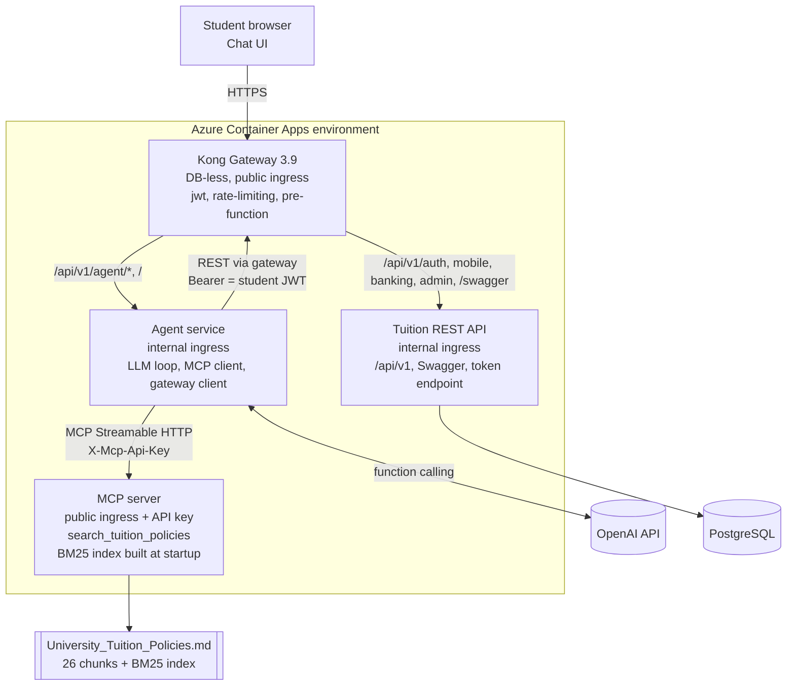

# AI Tuition Assistant (SE 4458 Midterm 1, Group 1)

[](https://github.com/CaganKoyunseven/tuition-assistant-mcp/actions/workflows/ci.yml)

A conversational assistant that answers student questions about tuition deadlines, installments, payment rules, balances and payments. For each question an LLM (OpenAI function calling) decides whether to search the university policy document through an **MCP server**, call the **Tuition REST API** through a **Kong API Gateway**, or both.

## 1. Demo video

**Video:** _link will be added here_ (screen recording of the deployed Azure system; it has no audio and no subtitles, the steps below describe what is shown).

| Time | What is shown |
|---|---|
| 0:00 | Architecture diagram |
| 0:20 | Azure resource group and the gateway URL |
| 0:40 | Swagger UI through the gateway: protected endpoint `401`, login, then `200` |
| 1:20 | Mobile query rate limit: 3 × `200`, then `429`; a different student still gets `200` |
| 1:50 | Chat UI: scenario 1 (MCP only), 2 (REST only), 3 (REST + MCP) with the tool-execution trace |
| 3:20 | Payment: pending card, **Confirm**, success, balance updated |
| 4:00 | Privacy: another student's balance is refused |
| 4:15 | MCP retrieval (McpDemo / MCP Inspector) |
| 4:45 | `dotnet test` and the CI badge |

## 2. Architecture



Workflow: `student question → LLM selects tools → agent executes MCP and/or REST (REST via the gateway) → tool results go back to the LLM → grounded answer with policy section references`.

- **The LLM never calls a service.** It only returns `tool_calls`; the agent executes them and feeds the results back (at most `Llm__MaxToolIterations` = 5 rounds).
- **REST path:** Agent → Kong → Tuition API → PostgreSQL. The agent calls Kong by its internal name, so even the agent's REST traffic passes the gateway (JWT check, rate limits, correlation id).
- **MCP path:** Agent (MCP client) → MCP server → in-memory BM25 index of the policy document. This path does not go through Kong; it is protected by the `X-Mcp-Api-Key` header.
- **Four request flows**
  1. *Policy question* ("When is the payment deadline?"): MCP only.
  2. *Account question* ("What is my balance?"): REST only (`get_my_tuition`).
  3. *Combined* ("Can I pay my outstanding balance in installments?"): REST (balance) + MCP (installment rules).
  4. *Payment*: `prepare_payment` (no money moves) → card with Confirm / Cancel → the student's click calls the Pay Tuition API.
- **Identity propagation:** the UI logs in at `POST /api/v1/auth/token` and keeps the JWT in memory. Kong validates it, the agent validates it again and takes `student_no` from it, and the **same JWT** is forwarded to the REST API. The student number in a REST path always comes from the JWT, never from the LLM or the user's text.
- In Azure the Tuition API and the agent have **internal-only ingress**, so the public entry points are Kong and the (API-key protected) MCP server.

## 3. Tech stack

| Area | Choice |
|---|---|
| Runtime | .NET 10, ASP.NET Core controllers |
| REST API | `Asp.Versioning.Mvc` (URL versioning), Swashbuckle (Swagger / OpenAPI), RFC 7807 ProblemDetails |
| Database | PostgreSQL 17, EF Core + Npgsql, migrations, idempotent seeder |
| Auth | RS256 JWT (`JwtBearer`), BCrypt password hashes |
| CSV import | CsvHelper |
| MCP server | official MCP C# SDK (`ModelContextProtocol.AspNetCore` 2.4.0), Streamable HTTP, own chunker, Porter stemmer and BM25 |
| Agent | official OpenAI .NET SDK (Chat Completions with tools), MCP C# client, static chat UI (HTML/JS) |
| Gateway | Kong Gateway 3.9 OSS, DB-less, declarative `kong.yml` |
| Tests | xUnit, `WebApplicationFactory`, SQLite in-memory (test double only), NSubstitute |
| CI | GitHub Actions (build + test) |
| Cloud | Azure Container Apps, Azure Container Registry, Azure Database for PostgreSQL Flexible Server |

## 4. Repository structure

```
src/TuitionAssistant.Api/        REST API, token endpoint, EF Core, migrations, seeder, Swagger
src/TuitionAssistant.Mcp/        MCP server, policy document, chunker / analyzer / BM25 index
src/TuitionAssistant.Agent/      agent service (LLM loop, tools, payment confirmation, traces) + chat UI (wwwroot)
tools/TuitionAssistant.McpDemo/  console client that calls the MCP server
tests/                           Api.Tests, Mcp.Tests, Agent.Tests (xUnit)
gateway/kong/                    Dockerfile, kong.yml.template, render-and-start.sh
deploy/azure/                    deploy.sh, teardown.sh, config.env.example
scripts/                         gen-keys.sh, smoke-test.sh, sample-data/ (CSV files)
documentation/                   ER diagram, OpenAPI export, evidence (screenshots, traces, logs)
docker-compose.yml               local stack: postgres, tuition-api, mcp-server, agent, kong
.github/workflows/ci.yml         CI
```

## 5. Quick start (local, docker compose)

Requirements: Docker with the compose plugin, `bash`, `openssl`, `curl`. (The .NET 10 SDK is only needed to run the tests or the MCP demo client.)

```bash
./scripts/gen-keys.sh            # RSA key pair in secrets/ (git-ignored); prints two lines for .env
cp .env.example .env             # paste the two JWT lines, set POSTGRES_PASSWORD and MCP_API_KEY
docker compose up --build        # postgres, tuition-api, mcp-server, agent, kong
./scripts/smoke-test.sh http://localhost:8000
```

| URL | What |
|---|---|
| `http://localhost:8000/swagger` | Swagger UI of the Tuition API (through Kong) |
| `http://localhost:8000/api/v1/...` | all REST operations (through Kong) |
| `http://localhost:8000/` | chat UI (served by the agent, through Kong) |
| `http://localhost:8081/mcp` | MCP server (header `X-Mcp-Api-Key`), for MCP Inspector / McpDemo |

Only Kong (8000) and the MCP server (8081) publish host ports. The Tuition API, the agent and PostgreSQL are reachable only inside the compose network, so every REST call has to pass the gateway. `docker compose down -v` removes the stack including the database volume (the seed runs again on the next start).

`scripts/smoke-test.sh` sends real requests through Kong and prints a PASS/FAIL table (login, mobile rate limit, 401/403, payment, duplicate payment, ProblemDetails passthrough, admin report, correlation id). Because the rate-limit check uses up the daily quota of its test students, set `MOBILE_STUDENT` / `MOBILE_OTHER_STUDENT` (e.g. `20239010` / `20239011`) to run it again on the same day without `down -v`.

## 6. Deployed URLs (Azure)

| What | URL |
|---|---|
| Gateway and chat UI | https://kong.wittygrass-1a837cae.switzerlandnorth.azurecontainerapps.io/ |
| Swagger UI (through the gateway) | https://kong.wittygrass-1a837cae.switzerlandnorth.azurecontainerapps.io/swagger |
| REST API base | `https://kong.wittygrass-1a837cae.switzerlandnorth.azurecontainerapps.io/api/v1/...` |
| MCP endpoint (header `X-Mcp-Api-Key`) | https://mcp-server.wittygrass-1a837cae.switzerlandnorth.azurecontainerapps.io/mcp |

Log in to the chat UI or Swagger with the demo credentials from [Test data](#test-data-seed) (`20230001` / `Student#2026`). The MCP endpoint answers `401` without the API key; the key is a deployment secret and is not published. The deployed agent uses it internally, so MCP can be tested through the chat UI, and directly with MCP Inspector or the demo client on the local stack (see [MCP server](#11-mcp-server)). The Tuition API and the agent are not reachable from the internet; every REST call has to pass Kong. Deployment details: [Cloud deployment](#14-cloud-deployment).

## 7. API Gateway

**Kong Gateway 3.9 (OSS)** runs in DB-less mode: the whole configuration is one declarative file, [`gateway/kong/kong.yml.template`](gateway/kong/kong.yml.template). At container start [`render-and-start.sh`](gateway/kong/render-and-start.sh) fills in the upstream URLs and the JWT public key from environment variables, validates the result with `kong config parse` and starts Kong. The same image therefore runs locally and in Azure.

### Route mapping

All routes keep the path unchanged (`strip_path: false`). Exact paths are anchored regexes, so no route can shadow another one; anything else returns Kong's `404 {"message":"no Route matched with those values"}`.

| Public path (gateway) | Method | Upstream | Auth at gateway | Plugins |
|---|---|---|---|---|
| `/api/v1/auth/token` | POST | tuition-api | none | rate-limiting 10/min per IP (brute-force protection) |
| `/api/v1/mobile/tuition/{studentNo}` | GET | tuition-api | none (as specified) | pre-function + rate-limiting **3/day per student number** |
| `/api/v1/banking/tuition/{studentNo}` | GET | tuition-api | JWT | jwt |
| `/api/v1/banking/payments` | POST | tuition-api | JWT | jwt |
| `/api/v1/admin/tuition` | POST | tuition-api | JWT | jwt |
| `/api/v1/admin/tuition/batch` | POST | tuition-api | JWT | jwt, request-size-limiting 2 MB |
| `/api/v1/admin/tuition/unpaid` | GET | tuition-api | JWT | jwt |
| `/swagger/...` | GET | tuition-api | none | – |
| `/api/v1/agent/...` | GET, POST | agent | JWT | jwt |
| `/`, `/index.html`, `/app.js`, `/styles.css` | GET | agent | none | – (static chat UI) |

Global plugins: `correlation-id` (adds `X-Request-ID` to the upstream request and echoes it in the response) and `response-transformer` (adds `X-Gateway: kong`).

### Authentication at the gateway

The `jwt` plugin verifies the RS256 signature with the public key of the token issuer (consumer `tuition-auth-issuer`, key = the token's `iss` claim `tuition-auth`) and checks `exp`. Tokens are accepted **only** from the `Authorization: Bearer` header, never from the query string or cookies. Kong checks *who signed the token*; *what the caller may do* (role, and a student reading only their own record) is enforced again by the Tuition API, so the API stays safe even if it were reached without the gateway.

```console
$ curl -i http://localhost:8000/api/v1/banking/tuition/20230001
HTTP/1.1 401 Unauthorized
{"message":"Unauthorized"}

$ curl -i -H "Authorization: Bearer $STUDENT_TOKEN" http://localhost:8000/api/v1/banking/tuition/20230001
HTTP/1.1 200 OK
X-Request-ID: 5d0c6a8e-...
X-Gateway: kong
{"studentNo":"20230001", ...}
```

### Rate limiting keyed by student number

Mobile Query Tuition is unauthenticated by specification, so it is limited to **3 calls per student number per day**, not per IP: a `pre-function` plugin (which runs before `rate-limiting`) takes the student number from the path and writes it into the `X-RateLimit-Student` header, overwriting any client-supplied value, and `rate-limiting` counts by that header.

```yaml
- name: pre-function
  config:
    access:
      - |
        local path = kong.request.get_path()
        local student = string.match(path, "^/api/v1/mobile/tuition/([^/]+)$") or "invalid"
        kong.service.request.set_header("X-RateLimit-Student", student)
- name: rate-limiting
  config:
    day: 3
    limit_by: header
    header_name: X-RateLimit-Student
    policy: local
    error_code: 429
    error_message: "Daily limit reached: max 3 tuition queries per student per day"
```

The 4th call for the same student returns Kong's 429, while a different student from the same IP still gets 200 (verified by the smoke test):

```console
$ curl -i http://localhost:8000/api/v1/mobile/tuition/20230004     # 4th call today
HTTP/1.1 429 Too Many Requests
RateLimit-Limit: 3
RateLimit-Remaining: 0
X-RateLimit-Limit-Day: 3
X-RateLimit-Remaining-Day: 0
Retry-After: 22459
{"message":"Daily limit reached: max 3 tuition queries per student per day", "request_id":"..."}
```

`policy: local` keeps counters in Kong's memory, which is correct for a single Kong instance (Kong runs with exactly one replica) but resets on restart. The Tuition API therefore keeps a second, persistent daily counter in PostgreSQL (`429 RATE_LIMIT_EXCEEDED`). The window is the calendar day in UTC.

### Errors through the gateway

Errors produced by Kong itself are small JSON bodies (`401 {"message":"Unauthorized"}`, `429` above, `413 {"message":"Request size limit exceeded"}`). Errors produced by the API pass through unchanged as ProblemDetails:

```console
$ curl -i -X POST -H "Authorization: Bearer $BANK_TOKEN" -H "Content-Type: application/json" \
    -d '{"studentNo":"20230001","term":"2026-FALL","amount":3500.00,"transactionId":"TXN-1"}' \
    http://localhost:8000/api/v1/banking/payments
HTTP/1.1 422 Unprocessable Entity
Content-Type: application/problem+json
{"title":"Amount exceeds balance","status":422,"code":"AMOUNT_EXCEEDS_BALANCE","currentBalance":3000.00, ...}
```

### Versioning

The version is part of the public path (`/api/v1/...`) and of the upstream path; the API also reports `api-supported-versions`. A future `v2` would be added as new routes next to the `v1` routes, so existing clients keep working.

## 8. Authentication and authorization

`POST /api/v1/auth/token` (public, limited to 10 requests/min per IP at the gateway) is an OAuth2-inspired token endpoint with a JSON body. It supports the equivalent of the OAuth 2.0 *password* grant (students, admin) and *client credentials* grant (banking app):

```json
{ "grantType": "password", "username": "20230001", "password": "Student#2026" }
{ "grantType": "client_credentials", "clientId": "bank-app", "clientSecret": "BankSecret#2026" }
```

```json
{ "accessToken": "<jwt>", "tokenType": "Bearer", "expiresIn": 3600, "role": "student", "studentNo": "20230001" }
```

A missing field or unknown `grantType` returns `400 VALIDATION_ERROR`; a wrong password or unknown user returns `401 INVALID_CREDENTIALS` (the same message for both, so user names cannot be probed).

**JWT:** RS256 with a 2048-bit RSA key. The private key exists only in the Tuition API; Kong, the agent and the API's own validation use the public key. Claims: `iss=tuition-auth`, `aud=tuition-api`, `sub`, `role` (`student` / `bank` / `admin`), `student_no` (students only), `jti`, `iat`, `nbf`, `exp` (60 minutes). Keys are generated by `scripts/gen-keys.sh` and never committed.

**Two validation layers (defense in depth):**

1. Kong `jwt` plugin on every protected route: signature and `exp`.
2. JwtBearer in the Tuition API and in the agent: issuer, audience, lifetime (30 s skew) and signing key, then the role and ownership rules below. The services never trust the gateway blindly.

| Route | Anonymous | student | bank | admin |
|---|---|---|---|---|
| `POST /api/v1/auth/token` | yes | – | – | – |
| `GET /api/v1/mobile/tuition/{studentNo}` | yes (3/student/day) | yes | yes | yes |
| `GET /api/v1/banking/tuition/{studentNo}` | 401 | own record only (else 403) | any student | 403 |
| `POST /api/v1/banking/payments` | 401 | own record only (else 403) | any student | 403 |
| `POST /api/v1/admin/tuition`, `/batch`, `GET /admin/tuition/unpaid` | 401 | 403 | 403 | yes |
| `/api/v1/agent/*` | 401 | yes (own session) | 403 | 403 |

**Why the agent cannot read another student's data:** the tool schemas have no student-number parameter; the agent takes the number from the JWT, forwards the student's own token, and the API compares the token's `student_no` with the requested record (`403 FORBIDDEN_NOT_OWNER`). A prompt such as "show the balance of 20230004" therefore cannot reach that data (scenario 5 in the [evidence](#19-evidence-index)). The batch endpoint is admin-only, because it modifies data, although the assignment's table does not list its authorization (see [Assumptions](#16-assumptions)).

## 9. REST API

The Tuition API is a REST API (JSON, camelCase) versioned by URL segment (`/api/v1/...`). Interactive documentation: **Swagger UI at `/swagger`** (through the gateway). The exported OpenAPI document is in [`documentation/openapi/v1.json`](documentation/openapi/v1.json).

### Endpoints

| # | Operation | Method & route | Auth | Success | Errors |
|---|---|---|---|---|---|
| 1 | Get token | `POST /api/v1/auth/token` | public | 200 | 400, 401 |
| 2 | Query Tuition (Mobile) | `GET /api/v1/mobile/tuition/{studentNo}?term=` | none, **3 calls / student / day** | 200 | 400, 404, 429 |
| 3 | Query Tuition (Banking) | `GET /api/v1/banking/tuition/{studentNo}?term=` | JWT: `bank` (any student) or `student` (own only) | 200 | 400, 401, 403, 404 |
| 4 | Pay Tuition | `POST /api/v1/banking/payments` | JWT: `bank` or `student` (own only) | 201 | 400, 401, 403, 404, 409, 422 |
| 5 | Add Tuition | `POST /api/v1/admin/tuition` | JWT: `admin` | 201 / 200 | 400, 401, 403, 422 |
| 6 | Add Tuition – Batch | `POST /api/v1/admin/tuition/batch` (multipart, field `file`) | JWT: `admin` | 200 | 400, 401, 403, 413 |
| 7 | Unpaid Tuition Status | `GET /api/v1/admin/tuition/unpaid?term=&page=&pageSize=` | JWT: `admin` | 200 | 400, 401, 403 |

### Term vs. overall balance (Query Tuition)

`term` is an optional query parameter (`YYYY-FALL`, `YYYY-SPRING` or `YYYY-SUMMER`, case-insensitive):

- **with `term`** → `"scope": "TERM"`; the totals are for that term (404 `TUITION_NOT_FOUND` if the student has no record for it);
- **without `term`** → `"scope": "OVERALL"`; the totals are summed over all terms and `terms[]` lists every term in chronological order.

```json
{
  "studentNo": "20230001", "scope": "TERM", "term": "2026-FALL", "currency": "USD",
  "tuitionTotal": 6000.00, "paidAmount": 3000.00, "balance": 3000.00, "status": "PARTIALLY_PAID",
  "terms": [ { "term": "2026-FALL", "tuitionTotal": 6000.00, "paidAmount": 3000.00, "balance": 3000.00, "status": "PARTIALLY_PAID" } ]
}
```

The mobile and banking endpoints return the same shape. The mobile response also carries `X-Daily-Limit` and `X-Daily-Remaining` headers.

### Mobile query limit (3 per student per day)

The limit is keyed by the **student number in the path**, not by the caller's IP, and the window is the **UTC calendar day**. It is enforced in two layers:

1. **Kong gateway** (`rate-limiting` keyed by a header that a `pre-function` sets from the path): this is the primary enforcement.
2. **API database counter** (`daily_query_counters`, atomic `INSERT … ON CONFLICT DO UPDATE … RETURNING`): survives gateway restarts (Kong keeps its counters in memory).

The 4th call returns `429 RATE_LIMIT_EXCEEDED` with a `Retry-After` header (seconds until the next UTC midnight).

### Pay Tuition

```json
// request
{ "studentNo": "20230001", "term": "2026-FALL", "amount": 1000.00, "transactionId": "BANK-2026-000123" }
// 201 response
{
  "status": "SUCCESS", "paymentId": "…", "transactionId": "BANK-2026-000123",
  "studentNo": "20230001", "term": "2026-FALL", "currency": "USD",
  "paidAmount": 1000.00, "totalPaid": 4000.00, "remainingBalance": 2000.00,
  "recordStatus": "PARTIALLY_PAID", "channel": "BANK_APP", "recordedAt": "2026-11-20T10:15:00Z"
}
```

Rules:

- Partial and full payments are allowed. Payments are **simulated**: no card data is accepted or stored, and they post immediately.
- **Duplicate `transactionId` → `409 DUPLICATE_TRANSACTION`**, and the balance is not changed. The response includes the original payment, unless it belongs to a student the caller is not allowed to see. The database enforces this with a unique index, so it also holds under concurrent requests.
- **Amount greater than the outstanding balance → `422 AMOUNT_EXCEEDS_BALANCE`** (with `currentBalance`). Overpayment is not supported. A fully paid term → `422 ALREADY_PAID`.
- Amounts must be > 0, ≤ 1,000,000.00 and have at most 2 decimals. Inputs are never rounded; `10.001` → `400 INVALID_AMOUNT`.
- Concurrent payments cannot overdraw a balance: each tuition record has an optimistic concurrency token, and a conflicting payment is retried once with fresh data.
- `channel` is `BANK_APP` for the bank role, `AI_AGENT` when a student token sends `X-Client-Channel: ai-agent` (the AI agent), and `STUDENT` otherwise.

### Add Tuition: duplicate handling

> **Add Tuition is an idempotent upsert keyed by (studentNo, term).** Re-sending the same record is safe (`200 UNCHANGED`). Sending a different amount updates the assessed total (`200 UPDATED`), unless it would fall below the amount already paid, which is rejected with `422 AMOUNT_BELOW_PAID`. A new (studentNo, term) returns `201 CREATED`.

Unknown student numbers are created automatically (`"studentCreated": true`), because the specification has no "create student" operation and the batch CSV contains only the student number. Only `USD` is accepted (`400 UNSUPPORTED_CURRENCY`).

### Add Tuition – Batch (CSV)

Upload with `multipart/form-data`, field `file`, max 1 MB and 5,000 data rows. The header must be exactly `studentNo,term,amount,currency` (case-insensitive):

```csv
studentNo,term,amount,currency
20240001,2027-SPRING,5000.00,USD
20240002,2027-SPRING,5500.00,USD
20230004,2026-FALL,4800.00,USD
```

Each row is processed independently with the single Add Tuition rules (partial success). Rows are applied in file order, so a later row for the same (studentNo, term) updates an earlier one. The response reports the counts and per-line errors (the header is line 1):

```json
{
  "batchId": "…", "totalRows": 5, "succeeded": 1, "failed": 4,
  "created": 1, "updated": 0, "unchanged": 0, "studentsCreated": 1,
  "errors": [
    { "line": 3, "studentNo": "2024X004", "term": "2027-SPRING", "code": "INVALID_STUDENT_NO", "message": "…" },
    { "line": 4, "studentNo": "20240005", "term": "2027-SPRING", "code": "UNSUPPORTED_CURRENCY", "message": "…" },
    { "line": 5, "studentNo": "20230003", "term": "2026-FALL", "code": "AMOUNT_BELOW_PAID", "message": "…" },
    { "line": 6, "studentNo": "20240006", "term": "2027-WINTER", "code": "INVALID_TERM", "message": "…" }
  ]
}
```

A file whose rows all fail still returns `200`, because the batch itself was processed. A wrong header or a header-only file returns `400 INVALID_CSV`. Sample files: [`scripts/sample-data/tuition-batch.csv`](scripts/sample-data/tuition-batch.csv) and [`scripts/sample-data/tuition-batch-with-errors.csv`](scripts/sample-data/tuition-batch-with-errors.csv).

### Unpaid Tuition Status (paging)

`term` is required. `page` is ≥ 1 (default 1) and `pageSize` is 1–100 (default 20). Results are records with a balance > 0, ordered by balance (highest first), then by student number. A page beyond the last returns an empty `items` list.

```json
{
  "term": "2026-FALL", "page": 1, "pageSize": 20, "totalCount": 28, "totalPages": 2,
  "totalOutstanding": 77275.00, "currency": "USD",
  "items": [ { "studentNo": "20230004", "fullName": "Can Yilmaz", "tuitionTotal": 4500.00, "paidAmount": 0.00, "balance": 4500.00, "status": "UNPAID" } ]
}
```

### Errors

Every error the API produces is an **RFC 7807 ProblemDetails** body (`application/problem+json`) with two extensions: `code` (machine-readable) and `traceId`:

```json
{
  "type": "https://httpstatuses.io/422",
  "title": "Amount exceeds balance",
  "status": 422,
  "detail": "Requested amount 3500.00 exceeds the outstanding balance 3000.00 for term 2026-FALL.",
  "instance": "/api/v1/banking/payments",
  "code": "AMOUNT_EXCEEDS_BALANCE",
  "traceId": "00-…",
  "currentBalance": 3000.00
}
```

| HTTP | `code` | When |
|---|---|---|
| 400 | `VALIDATION_ERROR` | missing/malformed fields, invalid paging, unknown grant type |
| 400 | `INVALID_STUDENT_NO` / `INVALID_TERM` / `INVALID_AMOUNT` / `INVALID_TRANSACTION_ID` | format rules |
| 400 | `UNSUPPORTED_CURRENCY` | currency is not USD |
| 400 | `INVALID_CSV` | missing file, wrong header, no data rows, unreadable CSV |
| 401 | `UNAUTHORIZED` / `INVALID_CREDENTIALS` | missing or invalid token / bad login |
| 403 | `FORBIDDEN` / `FORBIDDEN_NOT_OWNER` | role not allowed / student accessing another student |
| 404 | `NOT_FOUND` / `STUDENT_NOT_FOUND` / `TUITION_NOT_FOUND` | unknown route / student / term record |
| 409 | `DUPLICATE_TRANSACTION` / `CONCURRENCY_CONFLICT` | reused transaction ID / concurrent update |
| 413 | `PAYLOAD_TOO_LARGE` | CSV file > 1 MB |
| 422 | `AMOUNT_EXCEEDS_BALANCE` / `ALREADY_PAID` / `AMOUNT_BELOW_PAID` | business rules |
| 429 | `RATE_LIMIT_EXCEEDED` | 4th mobile query for a student on the same UTC day |
| 500 | `INTERNAL_ERROR` | unexpected error (no stack trace in the body) |

### Versioning

Controllers declare `[ApiVersion("1.0")]` and routes use `api/v{version:apiVersion}/...`. Responses carry `api-supported-versions: 1.0`. A future `v2` would add new controllers and new gateway routes while `v1` stays unchanged. Unversioned routes (e.g. `/api/mobile/tuition/...`) return 404.

## 10. Database

**PostgreSQL 17** is the server database in every running environment (local docker compose and Azure Database for PostgreSQL Flexible Server). Data access uses EF Core with the Npgsql provider.

> SQLite appears **only inside the automated unit tests** as an in-memory test double, so `dotnet test` runs without Docker or cloud resources. It is never used by the running system.


Table descriptions, constraints and the Mermaid source: [`documentation/er-diagram.md`](documentation/er-diagram.md).

### Migrations

EF Core migrations live in `src/TuitionAssistant.Api/Infrastructure/Migrations/`. With `Database__MigrateOnStartup=true` the API applies them at startup (retrying while the database is still starting). To apply or inspect them manually:

```bash
dotnet tool restore
dotnet ef database update --project src/TuitionAssistant.Api --connection "<postgres connection string>"
dotnet ef migrations script --project src/TuitionAssistant.Api     # print the SQL
```

### Test data (seed)

With `Database__SeedOnStartup=true` an idempotent seeder creates the data below (each row is inserted only if it does not exist yet, so restarts never duplicate data).

| Student | Name (fictitious) | Tuition records | Used for |
|---|---|---|---|
| `20230001` | Elif Demir | 2026-FALL: total 6,000.00, paid 3,000.00 (`SEED-TXN-0001`, `SEED-TXN-0002`) → **balance 3,000.00** | Main demo student |
| `20230002` | Mert Kaya | 2026-FALL: 4,500.00 fully paid (`SEED-TXN-0003`); 2027-SPRING: 4,500.00 unpaid | Term vs. overall balance; ownership tests |
| `20230003` | Zeynep Aydin | 2026-FALL: total 6,000.00, paid 5,750.00 (`SEED-TXN-0004`) → **balance 250.00** | Below the $300 installment threshold (Policy §3.1) |
| `20230004` | Can Yilmaz | 2026-FALL: 4,500.00 unpaid | No scholarship may be inferred (Policy §5.2) |
| `20239001`–`20239025` | Paging Student 01–25 | 2026-FALL: 1,000.00 + i × 137.00, unpaid | Unpaid report paging |

Demo logins (override with `SEED__ADMINPASSWORD`, `SEED__STUDENTPASSWORD`, `SEED__BANKCLIENTSECRET`):

| Username | Role | Password / client secret |
|---|---|---|
| `admin` | admin | `Admin#2026` |
| `bank-app` | bank (client credentials) | `BankSecret#2026` |
| `20230001` … `20230004` | student | `Student#2026` |

These credentials are for the demo only. Passwords are stored as BCrypt hashes.

## 11. MCP server

`src/TuitionAssistant.Mcp` is an ASP.NET Core service built with the official MCP C# SDK (`ModelContextProtocol.AspNetCore` 2.4.0). It exposes **one tool**, `search_tuition_policies`, over **Streamable HTTP** (stateless mode) at `POST /mcp`. Its only data source is the policy document [`src/TuitionAssistant.Mcp/Data/University_Tuition_Policies.md`](src/TuitionAssistant.Mcp/Data/University_Tuition_Policies.md); it never sees student balances or payments.

| Endpoint | Auth | Purpose |
|---|---|---|
| `POST /mcp` | header `X-Mcp-Api-Key` (value of `Mcp__ApiKey`, at least 16 characters) | MCP protocol (`initialize`, `tools/list`, `tools/call`) |
| `GET /health` | none | `{ status, service, documentId, chunks, indexedAtUtc, documentSha256 }` |

A missing or wrong key returns `401 {"error":"unauthorized", ...}`. The key is compared in constant time. The service refuses to start if `Mcp__ApiKey` is missing or shorter than 16 characters.

### Tool contract

Input schema (as returned by `tools/list`):

```json
{
  "type": "object",
  "properties": {
    "query": { "type": "string", "minLength": 2, "maxLength": 300,
               "description": "Natural-language search query in English, e.g. 'installment eligibility rules' (2-300 characters)." },
    "top_k": { "type": "integer", "minimum": 1, "maximum": 5, "default": 3,
               "description": "Number of excerpts to return (1-5, default 3)." }
  },
  "required": ["query"]
}
```

The tool is annotated as read-only, idempotent and non-destructive. Output (JSON text content, an extension of the format suggested in Policy §9):

```json
{
  "document": "University_Tuition_Policies.md",
  "documentId": "UNI-TUITION-2026-01",
  "query": "installment eligibility",
  "totalMatches": 1,
  "matches": [
    {
      "section": "3.1",
      "heading": "Eligibility",
      "parentHeading": "Installment policy",
      "text": "Students with an outstanding balance of at least **$300** may request an installment arrangement. ...",
      "score": 4.27
    }
  ]
}
```

- No relevant section: `totalMatches: 0`, `matches: []`, `message: "No relevant policy section found."`.
- Invalid input (empty or too long query, `top_k` outside 1–5): an MCP tool error result (`isError: true`) with a clear message, not a server crash.

### Chunking and indexing

The document is indexed **once at startup**, before the server accepts traffic (log line: `Indexed 26 chunks from UNI-TUITION-2026-01 (sha256 …) in 10 ms`). Queries only read the in-memory index; they never rebuild it (asserted by a unit test).

1. **Chunking** (`MarkdownChunker`): one chunk per `###` subsection (e.g. `3.2 Number and size of installments`). A `##` section without subsections becomes one chunk (sections 1 and 9), and the introductory scope notice becomes chunk `0`. Result: **26 chunks**: 0, 1, 2.1–2.3, 3.1–3.4, 4.1–4.3, 5.1–5.2, 6.1–6.3, 7.1–7.4, 8.1–8.4, 9. Each chunk keeps its section number, heading and parent heading, so every answer can cite its source section.
2. **Analysis** (`TextAnalyzer`): lower-case, Unicode NFKC, markdown symbols stripped, numbers kept (`300`, `2%` also emits `2`), English stop words removed, **Porter stemming** (own implementation, `PorterStemmer`, unit-tested).
3. **Ranking** (`Bm25Index`): Okapi **BM25** (`k1 = 1.2`, `b = 0.75`). The heading is indexed twice and the parent heading once in addition to the body, so headings weigh more. Results below `Policy__MinScore` (default 0.5) are dropped; ties are broken by section number.
4. **Query-time synonyms** (small, documented list): `deadline → due`, `instalment → installment`, `fee → late`, `penalty → fee, late`, `refund → withdrawal`, `scholarship → merit`, `pay → payment`, `split → installment`, `percent/percentage → %`.

Why BM25 instead of embeddings: the document is small and keyword-rich, BM25 is deterministic, needs no external service or API key, costs nothing per query and is fully testable with plain `dotnet test`.

### Running and calling it

```bash
# Docker (build context: repository root)
docker build -f src/TuitionAssistant.Mcp/Dockerfile -t tuition-mcp .
docker run --rm -p 8081:8080 -e Mcp__ApiKey=<at-least-16-characters> tuition-mcp

# or directly with the .NET SDK
Mcp__ApiKey=<key> dotnet run --project src/TuitionAssistant.Mcp --urls http://localhost:8081
```

- **Demo client** (`tools/TuitionAssistant.McpDemo`): connects over Streamable HTTP with the API key, calls `tools/list`, then runs the retrieval queries below (or your own queries as extra arguments):
  ```bash
  MCP_URL=http://localhost:8081/mcp MCP_API_KEY=<key> dotnet run --project tools/TuitionAssistant.McpDemo
  dotnet run --project tools/TuitionAssistant.McpDemo -- http://localhost:8081/mcp <key> "scholarship balance"
  ```
- **MCP Inspector**: `npx @modelcontextprotocol/inspector`, transport *Streamable HTTP*, URL `http://localhost:8081/mcp`, add the header `X-Mcp-Api-Key: <key>`, then *List Tools* and call `search_tuition_policies`. The CLI mode works too:
  ```bash
  npx @modelcontextprotocol/inspector --cli http://localhost:8081/mcp --transport http \
    --header "X-Mcp-Api-Key: <key>" --method tools/call \
    --tool-name search_tuition_policies --tool-arg query="installment eligibility"
  ```

### Retrieval test results

Output of the demo client against the Docker image (top 3 sections per query, BM25 score in brackets). Each top-1 result is also asserted by a unit test.

| # | Query | Top-1 section | Next results |
|---|---|---|---|
| 1 | `payment deadline fall term` | **2.1 Fall term** (8.88) | 2.2 Spring term (6.34), 8.1 When is the Fall tuition deadline? (5.63) |
| 2 | `how many installments can I split my balance into` | **3.2 Number and size of installments** (3.28) | 8.2 Can I pay my balance in three installments? (3.12), 3.4 Partial payments versus installment approval (2.97) |
| 3 | `refund if I withdraw early` | **6.1 Early withdrawal** (10.40) | 6.2 Later withdrawal (6.33), 6.3 Refund processing (6.13) |
| 4 (bonus) | `late fee percentage` | **4.1 Late fee rule** (8.61) | 4.2 Example (6.51), 4.3 Exceptions (5.17) |

## 12. AI Agent

The agent (`src/TuitionAssistant.Agent`) validates the student's JWT, keeps a short chat history per session and runs a tool-calling loop against an LLM. The model can use exactly three tools:

| Tool | Source | Purpose |
|---|---|---|
| `search_tuition_policies` | MCP server (discovered with `tools/list`) | policy questions |
| `get_my_tuition` | Tuition API through Kong, with the student's own token | live balance. There is **no** student-number parameter: the number always comes from the JWT |
| `prepare_payment` | agent (checks the live balance) | prepares a payment. It **never pays** |

Payments need the student's click: `prepare_payment` creates a single-use pending payment (5 minutes), the UI shows Confirm / Cancel, and only `POST /api/v1/agent/payments/{pendingId}/confirm` calls the Pay API (with `X-Client-Channel: ai-agent` and an idempotent transaction id). Typing "yes" in the chat never pays.

Endpoints (all need a `student` token): `POST /api/v1/agent/chat`, `GET /api/v1/agent/models`, `POST /api/v1/agent/payments/{pendingId}/confirm`, `POST /api/v1/agent/payments/{pendingId}/cancel`. Every chat answer carries a trace (LLM steps, tool calls with inputs/outputs, tokens, estimated cost); raw traces are also written to `Agent__TraceDirectory` (git-ignored).

### Chat UI

`http://localhost:8000/` (served by the agent through Kong; plain HTML/JS, no build step). Sign in with a demo student, then:

- ask your own question or click an example (MCP only, REST only, REST + MCP, payment, privacy test);
- every answer has an **Agent tool execution** panel like the assignment's sample screen: `LLM` (tool selection), `REST via Gateway`, `MCP`, `MCP Result` (section references) and the final `LLM` step, plus tokens and estimated cost; **Raw trace (JSON)** shows everything;
- a payment request shows a card (student, term, amount, balance, remaining, countdown) with **Confirm** and **Cancel**;
- the model dropdown in the header lists the models from `GET /api/v1/agent/models`.

The token is kept only in a JavaScript variable (a page refresh signs you out) and all text is inserted as plain text, never as HTML.

### Choosing the model and the API key

Bring your own key and model: both are plain configuration in `.env`, nothing is hardcoded.

| `.env` variable | Meaning |
|---|---|
| `OPENAI_API_KEY` | key of an OpenAI-compatible Chat Completions API (stays on the server, never sent to the browser) |
| `LLM_MODEL` | default model, `gpt-4o-mini` out of the box |
| `LLM_ALLOWED_MODELS` | optional comma-separated extra models a request may choose (`"model": "..."` in the chat body, listed by `GET /api/v1/agent/models`); any other value returns `400 MODEL_NOT_ALLOWED` |
| `LLM_BASE_URL` | only for another OpenAI-compatible provider |
| `LLM_PROVIDER` | `OpenAI` (real, graded mode) or `Fake` (offline keyword-based stand-in for demos without a key) |

> `gpt-4o-mini` is cheap, but OpenAI removes it from the API on **2027-01-14**. After that date set `LLM_MODEL` to a current model (for example `gpt-5-mini`) and restart the agent; no code change is needed. Price estimates in traces use `Llm__InputPricePerMillion` / `Llm__OutputPricePerMillion`.

## 13. Testing

```bash
dotnet test
```

Tests run with the .NET 10 SDK only: no Docker, no cloud and no OpenAI key are required (the Agent tests use a fake LLM, a fake MCP client and a fake gateway handler). One project only: `dotnet test --filter "FullyQualifiedName~Api.Tests"`. The console output of a full run is in [`documentation/evidence/test-run.txt`](documentation/evidence/test-run.txt); CI runs the same command on every push.

| Project | Tests | Covers |
|---|---|---|
| `TuitionAssistant.Api.Tests` | 152 | every REST operation with success and failure cases: token (valid / wrong password / bad grant), mobile query (term vs overall, invalid number, unknown student, 4th call → 429, counter reset on the next day), banking query (bank, own, other student 403, no token 401, admin 403), pay tuition (partial, full, duplicate 409, exceeds balance 422, invalid amount, already paid, other student 403), add tuition (created / unchanged / updated, below paid, bad currency, bad term, roles), batch CSV (counts, per-line errors, wrong header, header only, non-admin), unpaid report (paging, ordering, bounds, roles), ProblemDetails format, versioned routes, money helpers, concurrent payments |
| `TuitionAssistant.Mcp.Tests` | 93 | chunker (exact section list), analyzer and Porter stemmer, BM25 (top-1 section of the retrieval queries, irrelevant query → 0 matches), input validation, index built once, tool output shape, MCP client ↔ server over HTTP (`tools/list`, `tools/call`, missing key → 401) |
| `TuitionAssistant.Agent.Tests` | 64 | MCP-only, REST-only and combined tool flows, student number taken from the JWT only, `prepare_payment` never pays, confirm / cancel / expiry / wrong session, idempotent retry, loop guard, "press Confirm" claim without a prepared payment is corrected, tool errors passed to the LLM, trace redaction, schema conversion, cost calculator |

**Why SQLite appears in the tests:** the API tests use SQLite in-memory as a test double so that `dotnet test` needs no Docker and no cloud. It is never used by the running system: local compose and Azure both use PostgreSQL.

## 14. Cloud deployment

The system runs on **Azure Container Apps** with **Azure Database for PostgreSQL Flexible Server** (resource group `rg-se4458-tuition`; list of resources: [`azure-resources.txt`](documentation/evidence/azure-resources.txt)).

| Resource | Details |
|---|---|
| Container Registry | Basic; images `tuition-api`, `mcp-server`, `agent`, `kong` |
| Container Apps environment | `cae-se4458`, Consumption (switzerlandnorth) |
| `kong` | 0.5 vCPU / 1 GiB, exactly 1 replica, **external** ingress, port 8000 (public gateway) |
| `tuition-api` | 0.5 vCPU / 1 GiB, 1 replica, **internal** ingress, port 8080 |
| `agent` | 0.5 vCPU / 1 GiB, 1 replica (in-memory sessions), **internal** ingress |
| `mcp-server` | 0.5 vCPU / 1 GiB, 1 replica, **external** ingress, protected by an API key |
| PostgreSQL | Flexible Server 17, Burstable B1ms, SSL required, database `tuition` |

Inside the environment the apps call each other by app name (`http://tuition-api`, `http://mcp-server/mcp`, `http://kong`); the agent's `Gateway__BaseUrl` is the internal Kong address, so agent traffic still passes the gateway.

**Region note:** the subscription's region policy allows only a few regions, and PostgreSQL B1ms was available only in Denmark East, while Container Apps are not offered there. The database therefore runs in **Denmark East** and the four apps in **Switzerland North**. This adds a few milliseconds of latency per query and is acceptable for this workload.

### Deploy

```bash
az login                                  # an account that owns an Azure subscription
cp deploy/azure/config.env.example deploy/azure/config.env    # git-ignored; optional, created automatically
./deploy/azure/deploy.sh                  # idempotent: safe to re-run
```

The script registers the resource providers, creates the resource group, registry, database, environment and the four apps, then prints the gateway, Swagger and MCP URLs and runs `scripts/smoke-test.sh` against the gateway. Required inputs: the Azure login and an OpenAI API key (asked for with a silent prompt if `OPENAI_API_KEY` is blank). The PostgreSQL password, the MCP API key and a name suffix are generated on the first run.

**Secrets** (database password, JWT private key, MCP API key, OpenAI key) are stored as Container Apps secrets and referenced with `secretref:`; they are never in the repository. `config.env` is git-ignored; only `config.env.example` with placeholders is committed. The smoke test result on Azure: **23 / 23 checks passed** ([`smoke-test-azure.txt`](documentation/evidence/smoke-test-azure.txt)); the chat UI on Azure: [`azure-chat-ui.png`](documentation/evidence/azure-chat-ui.png).

Container images are built locally and pushed to the registry, because ACR build tasks are disabled for this subscription type. The script creates the environment in `ConsumptionOnly` mode, because the CLI's default environment type does not support the internal app-to-app routing this design needs.

### Cost control and teardown

- Set a budget alert (for example 20 USD) in Azure Cost Management.
- Stop the database when idle: `az postgres flexible-server stop --resource-group rg-se4458-tuition --name <server>` (Azure restarts a stopped server after 7 days).
- Remove everything after grading: `./deploy/azure/teardown.sh` (deletes the resource group, asks for confirmation).
- Approximate running cost: the B1ms database and four always-on 0.5 vCPU apps use a few USD per week of the free credit; the LLM cost is negligible (next section).

## 15. LLM cost and low-cost approach

Default model `gpt-4o-mini` (configurable, see [Choosing the model](#choosing-the-model-and-the-api-key)); estimates use 0.15 USD / 1M input tokens and 0.60 USD / 1M output tokens (`Llm__InputPricePerMillion`, `Llm__OutputPricePerMillion`). Measured on the demo scenarios (tokens and cost come from the saved traces in [`documentation/evidence/agent-traces/`](documentation/evidence/agent-traces)):

| Scenario | LLM calls | Input tokens | Output tokens | Estimated cost |
|---|---|---|---|---|
| 1 MCP only (payment deadline) | 2 | 2,127 | 65 | $0.00036 |
| 2 REST only (balance) | 2 | 1,994 | 55 | $0.00033 |
| 3 Combined (installments) | 3 | 3,333 | 98 | $0.00056 |
| 4 Payment, prepare step | 2 | 2,200 | 124 | $0.00040 |
| 5 Privacy refusal | 1 | 944 | 38 | $0.00016 |

A question costs a fraction of a cent; the whole demo is far below one cent per scenario. Measures to keep it low: a small model, at most 5 tool rounds per question (`MaxToolIterations`), a 20-message history per session (`HistoryMaxMessages`), a spending limit on the OpenAI project, the offline `Fake` provider for demos without a key, and all unit tests use a fake LLM (no API calls).

## 16. Assumptions

- **Identity:** students log in with student number + password (demo); the banking app is a machine client (client credentials, role `bank`) that may act for any student; admins use role `admin`. JWT RS256, 60 minutes.
- **Agent identity:** the agent always uses the signed-in student's JWT; tool schemas contain no student number; numbers typed in prompts are never used to access data.
- **Mobile Query Tuition** has no authentication, as specified. It is limited to 3 calls per student number per UTC day at the gateway (keyed by the number in the path, not the IP) and again in the API (database counter). It exposes a balance to anyone who knows a student number; this follows the specification and the agent never uses this endpoint.
- **Term vs. overall:** `term` is optional; without it the response contains overall totals plus a per-term breakdown.
- **Currency and amounts:** USD only; at most 2 decimals; the API never rounds (invalid precision → 400).
- **Installments and late fees** are not stored or calculated by the API. The agent explains the policy rules (equal parts, rounding difference in the last installment) but never confirms an approval or a posted fee. Late fee examples are illustrative.
- **Pay Tuition:** duplicate `transactionId` → 409; amount greater than the balance → 422; no overpayment; payments are simulated and post immediately (the two-business-day posting delay of Policy §2.3 is only stated by the agent, not simulated); no card data.
- **Add Tuition:** an upsert keyed by (studentNo, term); same amount → `UNCHANGED`; amount below what is already paid → 422; unknown students are created automatically, because the specification has no student-creation operation.
- **Batch:** row-by-row processing with partial success; a later row overrides an earlier row for the same (studentNo, term); at most 1 MB and 5,000 rows; admin-only although the assignment's authorization table does not list it.
- **Errors:** the API returns RFC 7807 ProblemDetails with a `code`; errors generated by Kong (401, 413, 429) use Kong's `{"message": ...}` body.
- **Database:** PostgreSQL 17 in every running environment; SQLite only inside the unit tests as an in-memory test double.
- **Rate-limit window:** UTC calendar day. Kong's counters are in memory (single replica); the database counter persists.
- **Deployment:** Azure Container Apps and Azure PostgreSQL; Tuition API and agent are internal-only, MCP is public but needs an API key. The database region differs from the app region (see [Cloud deployment](#14-cloud-deployment)).
- **Agent state:** conversations and pending payments are kept in memory (one agent replica); a pending payment expires after 5 minutes and can be used once.
- **LLM:** the OpenAI model is configuration (`LLM_MODEL`); the cost figures above are for `gpt-4o-mini`, which OpenAI retires from the API on 2027-01-14.
- **Policy document:** read-only reference, indexed once when the MCP server starts. It is not the tuition database. Retrieval is keyword-based (BM25), so queries should be in English.

## 17. Reproduce steps for the instructor

**Fastest check, no Docker and no key:** install the .NET 10 SDK and run `dotnet test`. All 309 tests pass.

**Full local stack:**

1. Install Docker (with compose), `bash`, `openssl`, `curl`.
2. `./scripts/gen-keys.sh`, then `cp .env.example .env` and paste the two JWT lines it prints; set `POSTGRES_PASSWORD` and `MCP_API_KEY` (`openssl rand -hex 24`).
3. Set `OPENAI_API_KEY` and `LLM_MODEL` for the real LLM, or `LLM_PROVIDER=Fake` for an offline walkthrough with keyword-based tool selection.
4. `docker compose up --build`
5. Open `http://localhost:8000/`, log in as `20230001` / `Student#2026` and run the example buttons:
   - *When is the payment deadline for the fall term?* → MCP only
   - *What is my balance?* → REST only (expected balance 3,000.00)
   - *Can I pay my outstanding balance in installments?* → REST + MCP
   - *Pay $100 of my 2026-FALL balance* → pending card → **Confirm** → balance 2,900.00
   - *What is the balance of student 20230002?* → refused
6. `./scripts/smoke-test.sh http://localhost:8000` prints a PASS/FAIL table (gateway 401 / 429, roles, payment, duplicate payment).
7. MCP retrieval: run the demo client or MCP Inspector as described in [MCP server](#11-mcp-server).
8. Swagger: `http://localhost:8000/swagger`; log in with `POST /api/v1/auth/token`, click **Authorize**, paste the token.

**Deployed system:** open the gateway URL from [Deployed URLs](#6-deployed-urls-azure) and use the same credentials and steps. The Azure database is seeded like the local one, so the same numbers apply (note that a payment changes the balance of `20230001`, and the mobile endpoint allows only 3 calls per student per day).

## 18. Known limitations

- Agent sessions, pending payments and Kong's rate-limit counters are in memory: the agent and Kong run as a single replica, and a restart clears them. The API's database counter keeps the mobile limit enforced after a restart.
- Payments are simulated and there is no refund or reversal operation.
- Policy retrieval is keyword-based (BM25 with a small synonym list), not semantic, and expects English queries.
- The gateway URL uses the platform's HTTPS certificate; the local stack uses plain HTTP.
- The database and the apps are in different Azure regions, because of the subscription's region and SKU restrictions.
- `gpt-4o-mini` is retired by OpenAI on 2027-01-14; change `LLM_MODEL` afterwards.
- No load testing was done (not required by the assignment).

## 19. Evidence index

All evidence lives in [`documentation/evidence/`](documentation/evidence/). Screenshots of the agent scenarios, Swagger and the payment were taken on the **deployed Azure system** (browser address bar shows the Azure gateway URL); the raw JSON traces next to them come from runs of the same questions on the local Docker Compose stack.

| Requirement | Evidence |
|---|---|
| Agent scenario 1, MCP only (policy question) | [screenshot (Azure)](documentation/evidence/azure-chat-scenario-1-mcp.png), [trace](documentation/evidence/agent-traces/s1-mcp-only.json) |
| Agent scenario 2, REST only (own balance) | [screenshot (Azure)](documentation/evidence/azure-chat-scenario-2-rest.png), [trace](documentation/evidence/agent-traces/s2-rest-only.json) |
| Agent scenario 3, combined REST + MCP | [screenshot (Azure)](documentation/evidence/azure-chat-ui.png), [trace (Azure)](documentation/evidence/agent-traces/azure-combined.json), [trace (local)](documentation/evidence/agent-traces/s3-combined.json) |
| Payment with explicit confirmation (prepare, then Confirm click, balance updated) | [screenshot (Azure)](documentation/evidence/azure-payment-confirmed.png), traces [prepare](documentation/evidence/agent-traces/payment-prepare.json) / [confirm](documentation/evidence/agent-traces/payment-confirm.json) |
| Privacy: another student's balance is refused | [screenshot (Azure)](documentation/evidence/azure-privacy-refusal.png), [trace](documentation/evidence/agent-traces/s5-privacy.json) |
| Below-threshold installment question | [trace](documentation/evidence/agent-traces/s6-below-threshold.json) |
| MCP retrieval, 3 queries (McpDemo console) | [mcp-retrieval.txt](documentation/evidence/mcp-retrieval.txt) |
| MCP Inspector: connect, tool list, tool call | [1 connected](documentation/evidence/mcp-inspector-1.png), [2 tool](documentation/evidence/mcp-inspector-2.png), [3 result](documentation/evidence/mcp-inspector-3.png) |
| Gateway protection, rate limit, error cases, local smoke test | [smoke-test-local.txt](documentation/evidence/smoke-test-local.txt) |
| Swagger UI (all operations) | [swagger-ui.png](documentation/evidence/swagger-ui.png) |
| Protected gateway route on Azure: `401` without a token, `200` with a token | [401](documentation/evidence/azure-swagger-401.png), [200](documentation/evidence/azure-swagger-200.png) |
| How the tests are run (`dotnet test`, 309 passing) | [tests-passing.png](documentation/evidence/tests-passing.png), [test-run.txt](documentation/evidence/test-run.txt) |
| CI (GitHub Actions, build and test on every push) | [ci-runs.png](documentation/evidence/ci-runs.png) |
| Azure deployment: URLs, resources, smoke test (23/23, includes the mobile `429` rate limit), chat UI | [azure-urls.txt](documentation/evidence/azure-urls.txt), [azure-resources.txt](documentation/evidence/azure-resources.txt), [smoke-test-azure.txt](documentation/evidence/smoke-test-azure.txt), [azure-chat-ui.png](documentation/evidence/azure-chat-ui.png), [combined scenario trace on Azure](documentation/evidence/agent-traces/azure-combined.json) |
