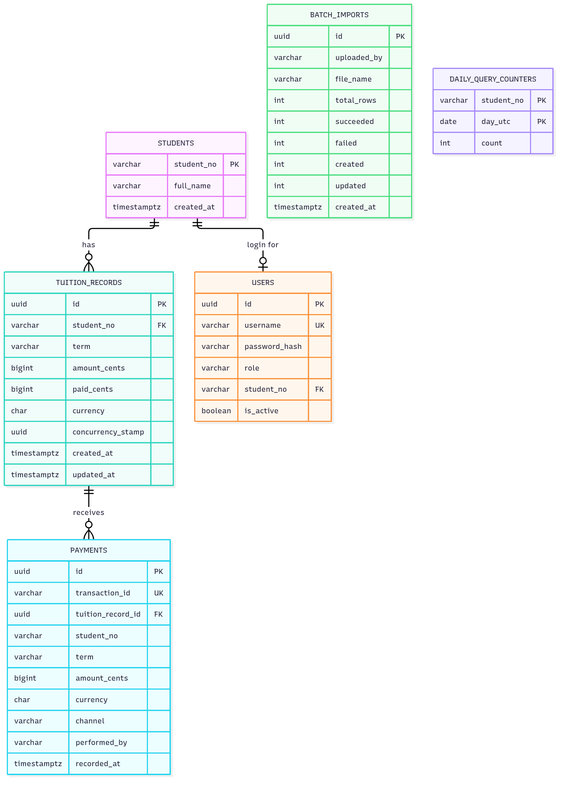

# AI Tuition Assistant (SE 4458 Midterm 1, Group 1)

[](https://github.com/CaganKoyunseven/tuition-assistant-mcp/actions/workflows/ci.yml)

A conversational assistant that answers student questions about tuition deadlines, installments, payment rules, balances and payments. For each question an LLM (OpenAI function calling) decides whether to search the university policy document through an **MCP server**, call the **Tuition REST API** through a **Kong API Gateway**, or both.

> This README is being filled in phase by phase. Sections marked _TBD_ are not written yet.

## 1. Demo video
_TBD_

## 2. Architecture
_TBD_

## 3. Tech stack
_TBD_

## 4. Repository structure
_TBD_

## 5. Quick start (local, docker compose)

Requirements: Docker with the compose plugin, `bash`, `openssl`, `curl`. (The .NET 10 SDK is only needed to run the tests or the MCP demo client.)

```bash
./scripts/gen-keys.sh            # RSA key pair in secrets/ (git-ignored); prints two lines for .env
cp .env.example .env             # paste the two JWT lines, set POSTGRES_PASSWORD and MCP_API_KEY
docker compose up --build        # postgres, tuition-api, mcp-server, agent, kong
./scripts/smoke-test.sh http://localhost:8000
```

| URL | What |
|---|---|
| `http://localhost:8000/swagger` | Swagger UI of the Tuition API (through Kong) |
| `http://localhost:8000/api/v1/...` | all REST operations (through Kong) |
| `http://localhost:8000/` | chat UI (served by the agent, through Kong) |
| `http://localhost:8081/mcp` | MCP server (header `X-Mcp-Api-Key`), for MCP Inspector / McpDemo |

Only Kong (8000) and the MCP server (8081) publish host ports. The Tuition API, the agent and PostgreSQL are reachable only inside the compose network, so every REST call has to pass the gateway. `docker compose down -v` removes the stack including the database volume (the seed runs again on the next start).

`scripts/smoke-test.sh` sends real requests through Kong and prints a PASS/FAIL table (login, mobile rate limit, 401/403, payment, duplicate payment, ProblemDetails passthrough, admin report, correlation id). Because the rate-limit check uses up the daily quota of its test students, set `MOBILE_STUDENT` / `MOBILE_OTHER_STUDENT` (e.g. `20239010` / `20239011`) to run it again on the same day without `down -v`.

## 6. Deployed URLs (Azure)
_TBD_

## 7. API Gateway

**Kong Gateway 3.9 (OSS)** runs in DB-less mode: the whole configuration is one declarative file, [`gateway/kong/kong.yml.template`](gateway/kong/kong.yml.template). At container start [`render-and-start.sh`](gateway/kong/render-and-start.sh) fills in the upstream URLs and the JWT public key from environment variables, validates the result with `kong config parse` and starts Kong. The same image therefore runs locally and in Azure.

### Route mapping

All routes keep the path unchanged (`strip_path: false`). Exact paths are anchored regexes, so no route can shadow another one; anything else returns Kong's `404 {"message":"no Route matched with those values"}`.

| Public path (gateway) | Method | Upstream | Auth at gateway | Plugins |
|---|---|---|---|---|
| `/api/v1/auth/token` | POST | tuition-api | none | rate-limiting 10/min per IP (brute-force protection) |
| `/api/v1/mobile/tuition/{studentNo}` | GET | tuition-api | none (as specified) | pre-function + rate-limiting **3/day per student number** |
| `/api/v1/banking/tuition/{studentNo}` | GET | tuition-api | JWT | jwt |
| `/api/v1/banking/payments` | POST | tuition-api | JWT | jwt |
| `/api/v1/admin/tuition` | POST | tuition-api | JWT | jwt |
| `/api/v1/admin/tuition/batch` | POST | tuition-api | JWT | jwt, request-size-limiting 2 MB |
| `/api/v1/admin/tuition/unpaid` | GET | tuition-api | JWT | jwt |
| `/swagger/...` | GET | tuition-api | none | – |
| `/api/v1/agent/...` | GET, POST | agent | JWT | jwt |
| `/`, `/index.html`, `/app.js`, `/styles.css` | GET | agent | none | – (static chat UI) |

Global plugins: `correlation-id` (adds `X-Request-ID` to the upstream request and echoes it in the response) and `response-transformer` (adds `X-Gateway: kong`).

### Authentication at the gateway

The `jwt` plugin verifies the RS256 signature with the public key of the token issuer (consumer `tuition-auth-issuer`, key = the token's `iss` claim `tuition-auth`) and checks `exp`. Tokens are accepted **only** from the `Authorization: Bearer` header, never from the query string or cookies. Kong checks *who signed the token*; *what the caller may do* (role, and a student reading only their own record) is enforced again by the Tuition API, so the API stays safe even if it were reached without the gateway.

```console
$ curl -i http://localhost:8000/api/v1/banking/tuition/20230001
HTTP/1.1 401 Unauthorized
{"message":"Unauthorized"}

$ curl -i -H "Authorization: Bearer $STUDENT_TOKEN" http://localhost:8000/api/v1/banking/tuition/20230001
HTTP/1.1 200 OK
X-Request-ID: 5d0c6a8e-...
X-Gateway: kong
{"studentNo":"20230001", ...}
```

### Rate limiting keyed by student number

Mobile Query Tuition is unauthenticated by specification, so it is limited to **3 calls per student number per day**, not per IP: a `pre-function` plugin (which runs before `rate-limiting`) takes the student number from the path and writes it into the `X-RateLimit-Student` header, overwriting any client-supplied value, and `rate-limiting` counts by that header.

```yaml
- name: pre-function
  config:
    access:
      - |
        local path = kong.request.get_path()
        local student = string.match(path, "^/api/v1/mobile/tuition/([^/]+)$") or "invalid"
        kong.service.request.set_header("X-RateLimit-Student", student)
- name: rate-limiting
  config:
    day: 3
    limit_by: header
    header_name: X-RateLimit-Student
    policy: local
    error_code: 429
    error_message: "Daily limit reached: max 3 tuition queries per student per day"
```

The 4th call for the same student returns Kong's 429, while a different student from the same IP still gets 200 (verified by the smoke test):

```console
$ curl -i http://localhost:8000/api/v1/mobile/tuition/20230004     # 4th call today
HTTP/1.1 429 Too Many Requests
RateLimit-Limit: 3
RateLimit-Remaining: 0
X-RateLimit-Limit-Day: 3
X-RateLimit-Remaining-Day: 0
Retry-After: 22459
{"message":"Daily limit reached: max 3 tuition queries per student per day", "request_id":"..."}
```

`policy: local` keeps counters in Kong's memory, which is correct for a single Kong instance (Kong runs with exactly one replica) but resets on restart. The Tuition API therefore keeps a second, persistent daily counter in PostgreSQL (`429 RATE_LIMIT_EXCEEDED`). The window is the calendar day in UTC.

### Errors through the gateway

Errors produced by Kong itself are small JSON bodies (`401 {"message":"Unauthorized"}`, `429` above, `413 {"message":"Request size limit exceeded"}`). Errors produced by the API pass through unchanged as ProblemDetails:

```console
$ curl -i -X POST -H "Authorization: Bearer $BANK_TOKEN" -H "Content-Type: application/json" \
    -d '{"studentNo":"20230001","term":"2026-FALL","amount":3500.00,"transactionId":"TXN-1"}' \
    http://localhost:8000/api/v1/banking/payments
HTTP/1.1 422 Unprocessable Entity
Content-Type: application/problem+json
{"title":"Amount exceeds balance","status":422,"code":"AMOUNT_EXCEEDS_BALANCE","currentBalance":3000.00, ...}
```

### Versioning

The version is part of the public path (`/api/v1/...`) and of the upstream path; the API also reports `api-supported-versions`. A future `v2` would be added as new routes next to the `v1` routes, so existing clients keep working.

## 8. Authentication and authorization
_TBD_

## 9. REST API

The Tuition API is a REST API (JSON, camelCase) versioned by URL segment (`/api/v1/...`). Interactive documentation: **Swagger UI at `/swagger`** (through the gateway). The exported OpenAPI document is in [`documentation/openapi/v1.json`](documentation/openapi/v1.json).

### Endpoints

| # | Operation | Method & route | Auth | Success | Errors |
|---|---|---|---|---|---|
| 1 | Get token | `POST /api/v1/auth/token` | public | 200 | 400, 401 |
| 2 | Query Tuition (Mobile) | `GET /api/v1/mobile/tuition/{studentNo}?term=` | none, **3 calls / student / day** | 200 | 400, 404, 429 |
| 3 | Query Tuition (Banking) | `GET /api/v1/banking/tuition/{studentNo}?term=` | JWT: `bank` (any student) or `student` (own only) | 200 | 400, 401, 403, 404 |
| 4 | Pay Tuition | `POST /api/v1/banking/payments` | JWT: `bank` or `student` (own only) | 201 | 400, 401, 403, 404, 409, 422 |
| 5 | Add Tuition | `POST /api/v1/admin/tuition` | JWT: `admin` | 201 / 200 | 400, 401, 403, 422 |
| 6 | Add Tuition – Batch | `POST /api/v1/admin/tuition/batch` (multipart, field `file`) | JWT: `admin` | 200 | 400, 401, 403, 413 |
| 7 | Unpaid Tuition Status | `GET /api/v1/admin/tuition/unpaid?term=&page=&pageSize=` | JWT: `admin` | 200 | 400, 401, 403 |

### Term vs. overall balance (Query Tuition)

`term` is an optional query parameter (`YYYY-FALL`, `YYYY-SPRING` or `YYYY-SUMMER`, case-insensitive):

- **with `term`** → `"scope": "TERM"`; the totals are for that term (404 `TUITION_NOT_FOUND` if the student has no record for it);
- **without `term`** → `"scope": "OVERALL"`; the totals are summed over all terms and `terms[]` lists every term in chronological order.

```json
{
  "studentNo": "20230001", "scope": "TERM", "term": "2026-FALL", "currency": "USD",
  "tuitionTotal": 6000.00, "paidAmount": 3000.00, "balance": 3000.00, "status": "PARTIALLY_PAID",
  "terms": [ { "term": "2026-FALL", "tuitionTotal": 6000.00, "paidAmount": 3000.00, "balance": 3000.00, "status": "PARTIALLY_PAID" } ]
}
```

The mobile and banking endpoints return the same shape. The mobile response also carries `X-Daily-Limit` and `X-Daily-Remaining` headers.

### Mobile query limit (3 per student per day)

The limit is keyed by the **student number in the path**, not by the caller's IP, and the window is the **UTC calendar day**. It is enforced in two layers:

1. **Kong gateway** (`rate-limiting` keyed by a header that a `pre-function` sets from the path): this is the primary enforcement.
2. **API database counter** (`daily_query_counters`, atomic `INSERT … ON CONFLICT DO UPDATE … RETURNING`): survives gateway restarts (Kong keeps its counters in memory).

The 4th call returns `429 RATE_LIMIT_EXCEEDED` with a `Retry-After` header (seconds until the next UTC midnight).

### Pay Tuition

```json
// request
{ "studentNo": "20230001", "term": "2026-FALL", "amount": 1000.00, "transactionId": "BANK-2026-000123" }
// 201 response
{
  "status": "SUCCESS", "paymentId": "…", "transactionId": "BANK-2026-000123",
  "studentNo": "20230001", "term": "2026-FALL", "currency": "USD",
  "paidAmount": 1000.00, "totalPaid": 4000.00, "remainingBalance": 2000.00,
  "recordStatus": "PARTIALLY_PAID", "channel": "BANK_APP", "recordedAt": "2026-11-20T10:15:00Z"
}
```

Rules:

- Partial and full payments are allowed. Payments are **simulated**: no card data is accepted or stored, and they post immediately.
- **Duplicate `transactionId` → `409 DUPLICATE_TRANSACTION`**, and the balance is not changed. The response includes the original payment, unless it belongs to a student the caller is not allowed to see. The database enforces this with a unique index, so it also holds under concurrent requests.
- **Amount greater than the outstanding balance → `422 AMOUNT_EXCEEDS_BALANCE`** (with `currentBalance`). Overpayment is not supported. A fully paid term → `422 ALREADY_PAID`.
- Amounts must be > 0, ≤ 1,000,000.00 and have at most 2 decimals. Inputs are never rounded; `10.001` → `400 INVALID_AMOUNT`.
- Concurrent payments cannot overdraw a balance: each tuition record has an optimistic concurrency token, and a conflicting payment is retried once with fresh data.
- `channel` is `BANK_APP` for the bank role, `AI_AGENT` when a student token sends `X-Client-Channel: ai-agent` (the AI agent), and `STUDENT` otherwise.

### Add Tuition: duplicate handling

> **Add Tuition is an idempotent upsert keyed by (studentNo, term).** Re-sending the same record is safe (`200 UNCHANGED`). Sending a different amount updates the assessed total (`200 UPDATED`), unless it would fall below the amount already paid, which is rejected with `422 AMOUNT_BELOW_PAID`. A new (studentNo, term) returns `201 CREATED`.

Unknown student numbers are created automatically (`"studentCreated": true`), because the specification has no "create student" operation and the batch CSV contains only the student number. Only `USD` is accepted (`400 UNSUPPORTED_CURRENCY`).

### Add Tuition – Batch (CSV)

Upload with `multipart/form-data`, field `file`, max 1 MB and 5,000 data rows. The header must be exactly `studentNo,term,amount,currency` (case-insensitive):

```csv
studentNo,term,amount,currency
20240001,2027-SPRING,5000.00,USD
20240002,2027-SPRING,5500.00,USD
20230004,2026-FALL,4800.00,USD
```

Each row is processed independently with the single Add Tuition rules (partial success). Rows are applied in file order, so a later row for the same (studentNo, term) updates an earlier one. The response reports the counts and per-line errors (the header is line 1):

```json
{
  "batchId": "…", "totalRows": 5, "succeeded": 1, "failed": 4,
  "created": 1, "updated": 0, "unchanged": 0, "studentsCreated": 1,
  "errors": [
    { "line": 3, "studentNo": "2024X004", "term": "2027-SPRING", "code": "INVALID_STUDENT_NO", "message": "…" },
    { "line": 4, "studentNo": "20240005", "term": "2027-SPRING", "code": "UNSUPPORTED_CURRENCY", "message": "…" },
    { "line": 5, "studentNo": "20230003", "term": "2026-FALL", "code": "AMOUNT_BELOW_PAID", "message": "…" },
    { "line": 6, "studentNo": "20240006", "term": "2027-WINTER", "code": "INVALID_TERM", "message": "…" }
  ]
}
```

A file whose rows all fail still returns `200`, because the batch itself was processed. A wrong header or a header-only file returns `400 INVALID_CSV`. Sample files: [`scripts/sample-data/tuition-batch.csv`](scripts/sample-data/tuition-batch.csv) and [`scripts/sample-data/tuition-batch-with-errors.csv`](scripts/sample-data/tuition-batch-with-errors.csv).

### Unpaid Tuition Status (paging)

`term` is required. `page` is ≥ 1 (default 1) and `pageSize` is 1–100 (default 20). Results are records with a balance > 0, ordered by balance (highest first), then by student number. A page beyond the last returns an empty `items` list.

```json
{
  "term": "2026-FALL", "page": 1, "pageSize": 20, "totalCount": 28, "totalPages": 2,
  "totalOutstanding": 77275.00, "currency": "USD",
  "items": [ { "studentNo": "20230004", "fullName": "Can Yilmaz", "tuitionTotal": 4500.00, "paidAmount": 0.00, "balance": 4500.00, "status": "UNPAID" } ]
}
```

### Errors

Every error the API produces is an **RFC 7807 ProblemDetails** body (`application/problem+json`) with two extensions: `code` (machine-readable) and `traceId`:

```json
{
  "type": "https://httpstatuses.io/422",
  "title": "Amount exceeds balance",
  "status": 422,
  "detail": "Requested amount 3500.00 exceeds the outstanding balance 3000.00 for term 2026-FALL.",
  "instance": "/api/v1/banking/payments",
  "code": "AMOUNT_EXCEEDS_BALANCE",
  "traceId": "00-…",
  "currentBalance": 3000.00
}
```

| HTTP | `code` | When |
|---|---|---|
| 400 | `VALIDATION_ERROR` | missing/malformed fields, invalid paging, unknown grant type |
| 400 | `INVALID_STUDENT_NO` / `INVALID_TERM` / `INVALID_AMOUNT` / `INVALID_TRANSACTION_ID` | format rules |
| 400 | `UNSUPPORTED_CURRENCY` | currency is not USD |
| 400 | `INVALID_CSV` | missing file, wrong header, no data rows, unreadable CSV |
| 401 | `UNAUTHORIZED` / `INVALID_CREDENTIALS` | missing or invalid token / bad login |
| 403 | `FORBIDDEN` / `FORBIDDEN_NOT_OWNER` | role not allowed / student accessing another student |
| 404 | `NOT_FOUND` / `STUDENT_NOT_FOUND` / `TUITION_NOT_FOUND` | unknown route / student / term record |
| 409 | `DUPLICATE_TRANSACTION` / `CONCURRENCY_CONFLICT` | reused transaction ID / concurrent update |
| 413 | `PAYLOAD_TOO_LARGE` | CSV file > 1 MB |
| 422 | `AMOUNT_EXCEEDS_BALANCE` / `ALREADY_PAID` / `AMOUNT_BELOW_PAID` | business rules |
| 429 | `RATE_LIMIT_EXCEEDED` | 4th mobile query for a student on the same UTC day |
| 500 | `INTERNAL_ERROR` | unexpected error (no stack trace in the body) |

### Versioning

Controllers declare `[ApiVersion("1.0")]` and routes use `api/v{version:apiVersion}/...`. Responses carry `api-supported-versions: 1.0`. A future `v2` would add new controllers and new gateway routes while `v1` stays unchanged. Unversioned routes (e.g. `/api/mobile/tuition/...`) return 404.

## 10. Database

**PostgreSQL 17** is the server database in every running environment (local docker compose and Azure Database for PostgreSQL Flexible Server). Data access uses EF Core with the Npgsql provider.

> SQLite appears **only inside the automated unit tests** as an in-memory test double, so `dotnet test` runs without Docker or cloud resources. It is never used by the running system.



Table descriptions, constraints and the Mermaid source: [`documentation/er-diagram.md`](documentation/er-diagram.md).

### Migrations

EF Core migrations live in `src/TuitionAssistant.Api/Infrastructure/Migrations/`. With `Database__MigrateOnStartup=true` the API applies them at startup (retrying while the database is still starting). To apply or inspect them manually:

```bash
dotnet tool restore
dotnet ef database update --project src/TuitionAssistant.Api --connection "<postgres connection string>"
dotnet ef migrations script --project src/TuitionAssistant.Api     # print the SQL
```

### Test data (seed)

With `Database__SeedOnStartup=true` an idempotent seeder creates the data below (each row is inserted only if it does not exist yet, so restarts never duplicate data).

| Student | Name (fictitious) | Tuition records | Used for |
|---|---|---|---|
| `20230001` | Elif Demir | 2026-FALL: total 6,000.00, paid 3,000.00 (`SEED-TXN-0001`, `SEED-TXN-0002`) → **balance 3,000.00** | Main demo student |
| `20230002` | Mert Kaya | 2026-FALL: 4,500.00 fully paid (`SEED-TXN-0003`); 2027-SPRING: 4,500.00 unpaid | Term vs. overall balance; ownership tests |
| `20230003` | Zeynep Aydin | 2026-FALL: total 6,000.00, paid 5,750.00 (`SEED-TXN-0004`) → **balance 250.00** | Below the $300 installment threshold (Policy §3.1) |
| `20230004` | Can Yilmaz | 2026-FALL: 4,500.00 unpaid | No scholarship may be inferred (Policy §5.2) |
| `20239001`–`20239025` | Paging Student 01–25 | 2026-FALL: 1,000.00 + i × 137.00, unpaid | Unpaid report paging |

Demo logins (override with `SEED__ADMINPASSWORD`, `SEED__STUDENTPASSWORD`, `SEED__BANKCLIENTSECRET`):

| Username | Role | Password / client secret |
|---|---|---|
| `admin` | admin | `Admin#2026` |
| `bank-app` | bank (client credentials) | `BankSecret#2026` |
| `20230001` … `20230004` | student | `Student#2026` |

These credentials are for the demo only. Passwords are stored as BCrypt hashes.

## 11. MCP server

`src/TuitionAssistant.Mcp` is an ASP.NET Core service built with the official MCP C# SDK (`ModelContextProtocol.AspNetCore` 2.4.0). It exposes **one tool**, `search_tuition_policies`, over **Streamable HTTP** (stateless mode) at `POST /mcp`. Its only data source is the policy document [`src/TuitionAssistant.Mcp/Data/University_Tuition_Policies.md`](src/TuitionAssistant.Mcp/Data/University_Tuition_Policies.md); it never sees student balances or payments.

| Endpoint | Auth | Purpose |
|---|---|---|
| `POST /mcp` | header `X-Mcp-Api-Key` (value of `Mcp__ApiKey`, at least 16 characters) | MCP protocol (`initialize`, `tools/list`, `tools/call`) |
| `GET /health` | none | `{ status, service, documentId, chunks, indexedAtUtc, documentSha256 }` |

A missing or wrong key returns `401 {"error":"unauthorized", ...}`. The key is compared in constant time. The service refuses to start if `Mcp__ApiKey` is missing or shorter than 16 characters.

### Tool contract

Input schema (as returned by `tools/list`):

```json
{
  "type": "object",
  "properties": {
    "query": { "type": "string", "minLength": 2, "maxLength": 300,
               "description": "Natural-language search query in English, e.g. 'installment eligibility rules' (2-300 characters)." },
    "top_k": { "type": "integer", "minimum": 1, "maximum": 5, "default": 3,
               "description": "Number of excerpts to return (1-5, default 3)." }
  },
  "required": ["query"]
}
```

The tool is annotated as read-only, idempotent and non-destructive. Output (JSON text content, an extension of the format suggested in Policy §9):

```json
{
  "document": "University_Tuition_Policies.md",
  "documentId": "UNI-TUITION-2026-01",
  "query": "installment eligibility",
  "totalMatches": 1,
  "matches": [
    {
      "section": "3.1",
      "heading": "Eligibility",
      "parentHeading": "Installment policy",
      "text": "Students with an outstanding balance of at least **$300** may request an installment arrangement. ...",
      "score": 4.27
    }
  ]
}
```

- No relevant section: `totalMatches: 0`, `matches: []`, `message: "No relevant policy section found."`.
- Invalid input (empty or too long query, `top_k` outside 1–5): an MCP tool error result (`isError: true`) with a clear message, not a server crash.

### Chunking and indexing

The document is indexed **once at startup**, before the server accepts traffic (log line: `Indexed 26 chunks from UNI-TUITION-2026-01 (sha256 …) in 10 ms`). Queries only read the in-memory index; they never rebuild it (asserted by a unit test).

1. **Chunking** (`MarkdownChunker`): one chunk per `###` subsection (e.g. `3.2 Number and size of installments`). A `##` section without subsections becomes one chunk (sections 1 and 9), and the introductory scope notice becomes chunk `0`. Result: **26 chunks**: 0, 1, 2.1–2.3, 3.1–3.4, 4.1–4.3, 5.1–5.2, 6.1–6.3, 7.1–7.4, 8.1–8.4, 9. Each chunk keeps its section number, heading and parent heading, so every answer can cite its source section.
2. **Analysis** (`TextAnalyzer`): lower-case, Unicode NFKC, markdown symbols stripped, numbers kept (`300`, `2%` also emits `2`), English stop words removed, **Porter stemming** (own implementation, `PorterStemmer`, unit-tested).
3. **Ranking** (`Bm25Index`): Okapi **BM25** (`k1 = 1.2`, `b = 0.75`). The heading is indexed twice and the parent heading once in addition to the body, so headings weigh more. Results below `Policy__MinScore` (default 0.5) are dropped; ties are broken by section number.
4. **Query-time synonyms** (small, documented list): `deadline → due`, `instalment → installment`, `fee → late`, `penalty → fee, late`, `refund → withdrawal`, `scholarship → merit`, `pay → payment`, `split → installment`, `percent/percentage → %`.

Why BM25 instead of embeddings: the document is small and keyword-rich, BM25 is deterministic, needs no external service or API key, costs nothing per query and is fully testable with plain `dotnet test`.

### Running and calling it

```bash
# Docker (build context: repository root)
docker build -f src/TuitionAssistant.Mcp/Dockerfile -t tuition-mcp .
docker run --rm -p 8081:8080 -e Mcp__ApiKey=<at-least-16-characters> tuition-mcp

# or directly with the .NET SDK
Mcp__ApiKey=<key> dotnet run --project src/TuitionAssistant.Mcp --urls http://localhost:8081
```

- **Demo client** (`tools/TuitionAssistant.McpDemo`): connects over Streamable HTTP with the API key, calls `tools/list`, then runs the retrieval queries below (or your own queries as extra arguments):
  ```bash
  MCP_URL=http://localhost:8081/mcp MCP_API_KEY=<key> dotnet run --project tools/TuitionAssistant.McpDemo
  dotnet run --project tools/TuitionAssistant.McpDemo -- http://localhost:8081/mcp <key> "scholarship balance"
  ```
- **MCP Inspector**: `npx @modelcontextprotocol/inspector`, transport *Streamable HTTP*, URL `http://localhost:8081/mcp`, add the header `X-Mcp-Api-Key: <key>`, then *List Tools* and call `search_tuition_policies`. The CLI mode works too:
  ```bash
  npx @modelcontextprotocol/inspector --cli http://localhost:8081/mcp --transport http \
    --header "X-Mcp-Api-Key: <key>" --method tools/call \
    --tool-name search_tuition_policies --tool-arg query="installment eligibility"
  ```

### Retrieval test results

Output of the demo client against the Docker image (top 3 sections per query, BM25 score in brackets). Each top-1 result is also asserted by a unit test.

| # | Query | Top-1 section | Next results |
|---|---|---|---|
| 1 | `payment deadline fall term` | **2.1 Fall term** (8.88) | 2.2 Spring term (6.34), 8.1 When is the Fall tuition deadline? (5.63) |
| 2 | `how many installments can I split my balance into` | **3.2 Number and size of installments** (3.28) | 8.2 Can I pay my balance in three installments? (3.12), 3.4 Partial payments versus installment approval (2.97) |
| 3 | `refund if I withdraw early` | **6.1 Early withdrawal** (10.40) | 6.2 Later withdrawal (6.33), 6.3 Refund processing (6.13) |
| 4 (bonus) | `late fee percentage` | **4.1 Late fee rule** (8.61) | 4.2 Example (6.51), 4.3 Exceptions (5.17) |

## 12. AI Agent

The agent (`src/TuitionAssistant.Agent`) validates the student's JWT, keeps a short chat history per session and runs a tool-calling loop against an LLM. The model can use exactly three tools:

| Tool | Source | Purpose |
|---|---|---|
| `search_tuition_policies` | MCP server (discovered with `tools/list`) | policy questions |
| `get_my_tuition` | Tuition API through Kong, with the student's own token | live balance. There is **no** student-number parameter: the number always comes from the JWT |
| `prepare_payment` | agent (checks the live balance) | prepares a payment. It **never pays** |

Payments need the student's click: `prepare_payment` creates a single-use pending payment (5 minutes), the UI shows Confirm / Cancel, and only `POST /api/v1/agent/payments/{pendingId}/confirm` calls the Pay API (with `X-Client-Channel: ai-agent` and an idempotent transaction id). Typing "yes" in the chat never pays.

Endpoints (all need a `student` token): `POST /api/v1/agent/chat`, `GET /api/v1/agent/models`, `POST /api/v1/agent/payments/{pendingId}/confirm`, `POST /api/v1/agent/payments/{pendingId}/cancel`. Every chat answer carries a trace (LLM steps, tool calls with inputs/outputs, tokens, estimated cost); raw traces are also written to `Agent__TraceDirectory` (git-ignored).

### Choosing the model and the API key

Bring your own key and model: both are plain configuration in `.env`, nothing is hardcoded.

| `.env` variable | Meaning |
|---|---|
| `OPENAI_API_KEY` | key of an OpenAI-compatible Chat Completions API (stays on the server, never sent to the browser) |
| `LLM_MODEL` | default model, `gpt-4o-mini` out of the box |
| `LLM_ALLOWED_MODELS` | optional comma-separated extra models a request may choose (`"model": "..."` in the chat body, listed by `GET /api/v1/agent/models`); any other value returns `400 MODEL_NOT_ALLOWED` |
| `LLM_BASE_URL` | only for another OpenAI-compatible provider |
| `LLM_PROVIDER` | `OpenAI` (real, graded mode) or `Fake` (offline keyword-based stand-in for demos without a key) |

> `gpt-4o-mini` is cheap, but OpenAI removes it from the API on **2027-01-14**. After that date set `LLM_MODEL` to a current model (for example `gpt-5-mini`) and restart the agent; no code change is needed. Price estimates in traces use `Llm__InputPricePerMillion` / `Llm__OutputPricePerMillion`.

## 13. Testing

```bash
dotnet test
```

Tests run with the .NET 10 SDK only: no Docker, no cloud and no OpenAI key are required.

## 14. Cloud deployment
_TBD_

## 15. LLM cost and low-cost approach
_TBD_

## 16. Assumptions
_TBD_

## 17. Reproduce steps for the instructor
_TBD_

## 18. Known limitations
_TBD_

## 19. Evidence index
_TBD_
