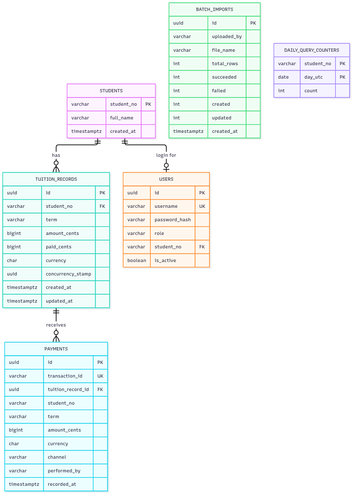
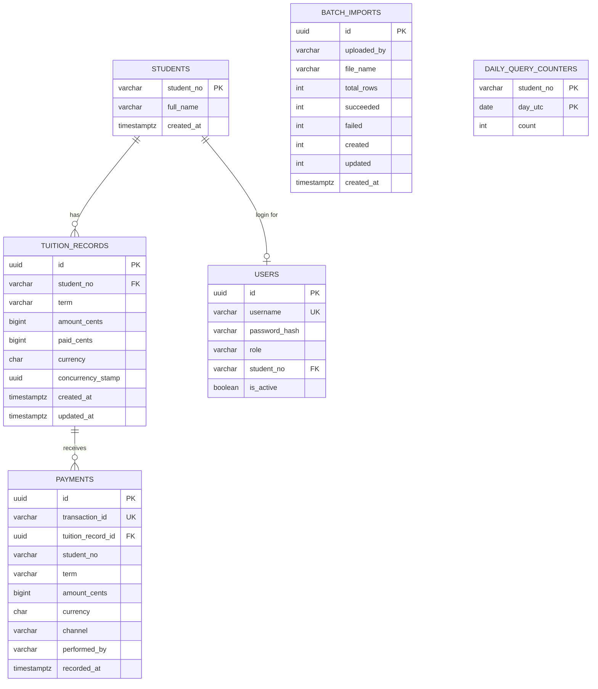

# ER diagram

The Tuition REST API stores its data in **PostgreSQL 17** (Azure Database for PostgreSQL Flexible Server in the cloud, `postgres:17-alpine` locally). The schema is created by EF Core migrations in `src/TuitionAssistant.Api/Infrastructure/Migrations/`.

## Tables

| Table | Purpose | Key constraints |
|---|---|---|
| `students` | Student master data (8-digit student number). | PK `student_no` |
| `tuition_records` | Assessed tuition per student and term; `paid_cents` is the running total of payments. | UNIQUE (`student_no`, `term`); CHECK `amount_cents >= 0`; CHECK `0 <= paid_cents <= amount_cents`; `concurrency_stamp` optimistic concurrency token; index on `term` |
| `payments` | Simulated payments (no card data). `student_no`/`term` are denormalized for auditing. | UNIQUE `transaction_id` (duplicate rejection); CHECK `amount_cents > 0`; FK → `tuition_records` |
| `users` | Login identities: students (username = student number), the banking app (machine client) and admins. Passwords/secrets are BCrypt hashes. | UNIQUE `username`; UNIQUE nullable FK `student_no` (at most one login per student) |
| `batch_imports` | Audit row per processed Add Tuition batch (CSV) upload. | PK `id` |
| `daily_query_counters` | Persistent second layer of the 3-per-day mobile query limit (the gateway is the first layer). No FK, so unknown student numbers are counted too. | PK (`student_no`, `day_utc`) |

## Design notes

- **Money is stored as integer cents (`bigint`).** Arithmetic is exact and sorting by balance works in every provider. The API exposes decimals with two places and rejects inputs with more than two decimals instead of rounding.
- **Balance is not stored.** It is always `amount_cents − paid_cents`, so it can never drift from the payments.
- **Status is derived:** `UNPAID` (nothing paid), `PARTIALLY_PAID`, `PAID` (paid = total).
- **Timestamps are UTC** (`timestamptz`).
- **SQLite is used only inside the automated unit tests** as an in-memory test double. It is never the server database of a running environment.
